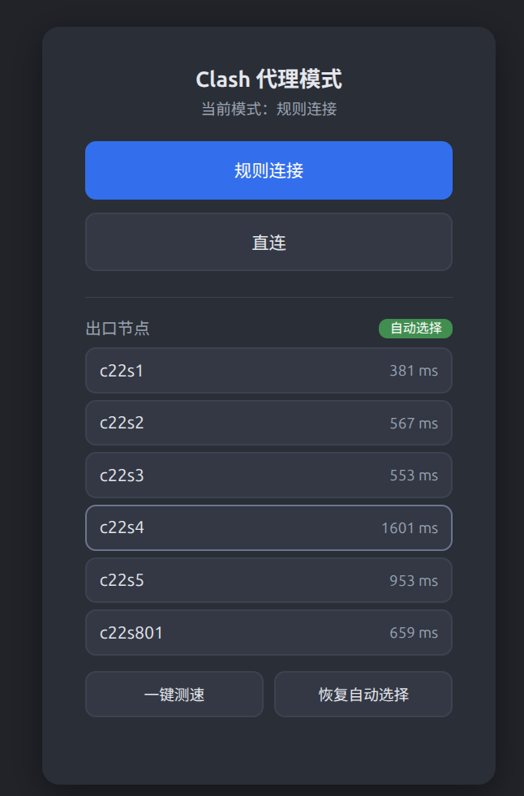

# clash-mode-switcher

在 mihomo（Clash Meta）代理的「规则连接 / 直连」模式间一键切换的两种方式：**Web 页面**和 **CLI 脚本**。两种方式共用一个 API（`PATCH /configs` 的 `mode` 字段），互不干扰。

## 方式一：Web 页面
mihomo 自带 external-ui 机制，一个 `index.html` 即可，零依赖、零额外进程。


### 部署

```bash
# 1. 放页面（mihomo 工作目录假设为 ~/Documents/clash，下同）
mkdir -p ~/Documents/clash/ui
cp index.html ~/Documents/clash/ui/

# 2. 在激活的 profile 里 external-controller 行后加一行：
#    external-ui: ui

# 3. 重启
systemctl --user restart mihomo
```

浏览器打开 **http://127.0.0.1:9090/ui/** 即可查看当前模式并一键切换。

### 节点面板

页面下半部分为出口节点面板：

- 显示 6 个节点与最近延迟，绿色徽标「自动选择」表示当前由 url-test 自动挑最快节点
- **一键测速**：并发测试全部节点延迟，超时节点标红
- **点击节点行**：固定该节点为出口（`PUT /proxies/PROXY`）；**恢复自动选择**切回自动

### 坑

- **MetaCubeXD 自动下载**：mihomo 在 `ui` 目录为空且配置重载时会自动下载 MetaCubeXD 面板并清空重建该目录；目录非空则跳过。**切勿清空 `ui` 目录后重启/重载 mihomo**。
- `PATCH /configs` 成功返回 **204 空 body**，判断结果只看 HTTP 状态码。
- 页面与 API 仅监听 127.0.0.1；mihomo API 默认无 secret 且带 `Access-Control-Allow-Origin: *`，如需收紧可给 `external-controller` 加 secret（会连带改动页面与脚本）。

## 方式二：CLI 脚本

```bash
cp clash-mode ~/.local/bin/ && chmod +x ~/.local/bin/clash-mode

clash-mode             # 查看当前模式
clash-mode direct      # 切直连
clash-mode rule        # 切规则代理
clash-mode toggle      # 一键互切
clash-mode nodes       # 节点列表（最近延迟 + 当前出口标记）
clash-mode test        # 一键测速（并发全部节点，超时标红）
clash-mode use c22s3   # 固定出口（接受缩写或完整节点名）
clash-mode auto        # 恢复自动选择
```

功能与 Web 页面一致：`use`/`auto` 即页面里的点节点行/恢复自动，`test` 即页面的一键测速。

## 测速原理

页面与脚本的「测速」实际是**延迟测量**（毫秒级往返耗时），不是带宽测试；测量发生在 **mihomo 服务端**，前端/脚本只负责发起与展示：

1. 客户端调 mihomo API：`GET /proxies/{节点名}/delay?url=...&timeout=8000`
2. mihomo 以**指定节点**为出站建立代理隧道，通过隧道访问测试 URL
3. 测试 URL 固定为 Google 的 `http://www.gstatic.com/generate_204`——返回 HTTP 204 空 body，负载极小且基础设施稳定，因此测得的是链路延迟而非下载速度
4. mihomo 返回 `{"delay": <毫秒>}`；失败/超时返回 `{"message":"Timeout"}`
5. 客户端并发发起全部节点的测试（页面用 `Promise.allSettled`，脚本用后台 `&` + `wait`），单节点 8 秒上限，逐行更新，失败标红

`自动选择快速节点` 分组内部也用同一套 URLTest 逻辑周期测速选优（profile 里 `interval: 300`，每 5 分钟一轮），页面/脚本的一键测速相当于手动触发一次同样的测量并可视化结果。

**注意**：延迟低 ≠ 带宽大（机场节点常见「测速漂亮、跑流量拉胯」）。真正测吞吐需要下载大文件计时，不在本项目范围内。

## 适用版本

mihomo v1.19.28（实测）；API 与 external-ui 为 Clash Meta 长期稳定功能，其他相近版本应同样适用。
